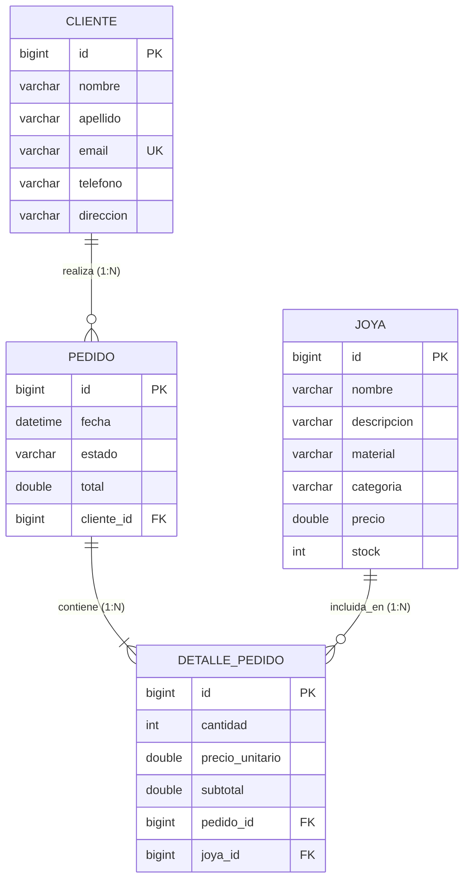

# 💎 API REST - Tienda de Venta de Joyas (TIF)

Backend completo desarrollado con **Spring Boot**, **Spring Data JPA**, **Hibernate** y **MySQL**, que expone una API RESTful JSON para la gestión integral de una joyería de alta gama.

El sistema implementa una arquitectura limpia y organizada en capas: **Controller**, **Service**, **Repository**, **Model (Entidades)** y **DTO (Request / Response)**, junto con un gestor global de excepciones y una batería completa de pruebas con la herramienta **Bruno** y tests automatizados con **JUnit 5**.

---

## 📋 Tabla de Contenidos

1. [Arquitectura y Organización en Capas](#-arquitectura-y-organización-en-capas)
2. [Entidades del Modelo y Relaciones](#-entidades-del-modelo-y-relaciones)
3. [Reglas de Negocio y Dominio Requeridas](#-reglas-de-negocio-y-dominio-requeridas)
4. [Paso a Paso de Construcción del Proyecto](#-paso-a-paso-de-construcción-del-proyecto)
5. [Catálogo de Endpoints de la API (CRUD)](#-catálogo-de-endpoints-de-la-api-crud)
6. [Colección de Pruebas con Bruno](#-colección-de-pruebas-con-bruno)
7. [Instrucciones de Configuración y Ejecución](#-instrucciones-de-configuración-y-ejecución)
8. [Verificación de Tests Automatizados](#-verificación-de-tests-automatizados)

---

## 🏛 Arquitectura y Organización en Capas

El backend respeta el principio de separación de responsabilidades a través de paquetes específicos:

```
src/main/java/ar/edu/centro8/daw/tif/
│
├── config/                  # Inicializadores y configuración del sistema
│   └── DataInitializer.java # Precarga automática de datos de prueba en MySQL
│
├── controller/              # Capa de entrada web / Endpoints REST JSON
│   ├── ClienteController.java
│   ├── JoyaController.java
│   ├── PedidoController.java
│   └── DetallePedidoController.java
│
├── dto/                     # Objetos de Transferencia de Datos
│   ├── request/             # Datos de entrada con validaciones Jakarta
│   │   ├── ClienteRequestDTO.java
│   │   ├── JoyaRequestDTO.java          <-- Regla de negocio en RequestDTO
│   │   ├── PedidoRequestDTO.java
│   │   ├── PedidoUpdateRequestDTO.java
│   │   ├── DetallePedidoItemDTO.java
│   │   └── DetallePedidoRequestDTO.java
│   └── response/            # Datos formateados para el cliente consumidor
│       ├── ClienteResponseDTO.java
│       ├── JoyaResponseDTO.java         <-- Regla de negocio en ResponseDTO
│       ├── PedidoResponseDTO.java
│       └── DetallePedidoResponseDTO.java
│
├── exception/               # Manejo centralizado de errores REST
│   ├── BusinessRuleException.java
│   ├── ResourceNotFoundException.java
│   ├── ErrorResponse.java
│   └── GlobalExceptionHandler.java
│
├── mapper/                  # Conversores entre entidades y DTOs
│   ├── ClienteMapper.java
│   ├── JoyaMapper.java
│   └── PedidoMapper.java
│
├── model/                   # Entidades de dominio JPA mapeadas a MySQL
│   ├── Cliente.java
│   ├── Joya.java                        <-- Regla de dominio en entidad
│   ├── Pedido.java
│   └── DetallePedido.java
│
├── repository/              # Acceso a datos con Spring Data JPA
│   ├── ClienteRepository.java
│   ├── JoyaRepository.java
│   ├── PedidoRepository.java
│   └── DetallePedidoRepository.java
│
└── service/                 # Lógica de negocio y transaccionalidad
    ├── ClienteService.java
    ├── JoyaService.java
    ├── PedidoService.java               <-- Regla de negocio en Service
    ├── DetallePedidoService.java
    └── impl/
        ├── ClienteServiceImpl.java
        ├── JoyaServiceImpl.java
        ├── PedidoServiceImpl.java
        └── DetallePedidoServiceImpl.java
```

---

## 💎 Entidades del Modelo y Relaciones

El modelo de datos comprende 4 entidades principales interconectadas:

1. **`Cliente`**: Representa al comprador o usuario. Posee datos personales (`nombre`, `apellido`, `email` único, `telefono`, `direccion`) y mantiene una relación `@OneToMany` con sus pedidos.
2. **`Joya`**: Representa el catálogo de productos de la joyería (`nombre`, `descripcion`, `material`, `categoria`, `precio`, `stock`). Contiene lógica de dominio para proteger sus existencias.
3. **`Pedido`**: Orden de compra registrada a nombre de un cliente (`@ManyToOne` con `Cliente`). Contiene la `fecha`, el `estado` (PENDIENTE, PAGADO, ENVIADO, CANCELADO), el `total` acumulado y una lista `@OneToMany` de detalles.
4. **`DetallePedido`**: Renglón individual dentro de un pedido (`@ManyToOne` con `Pedido` y `@ManyToOne` con `Joya`). Congela el `precioUnitario`, la `cantidad` adquirida y calcula el `subtotal`.

### Diagrama Entidad-Relación



---

## 🎯 Reglas de Negocio y Dominio Requeridas

El proyecto implementa de manera estricta y explícita las 4 reglas solicitadas en la consigna:

### 1. Regla de Negocio en el RequestDTO (`JoyaRequestDTO`)
* **Ubicación:** `ar.edu.centro8.daw.tif.dto.request.JoyaRequestDTO`
* **Definición:** Valida al momento de recibir el payload JSON que si la joya está fabricada en materiales preciosos de alto valor (**"Oro"** o **"Platino"**), su precio unitario no puede ser inferior a **$50.000,00 ARS**.
* **Implementación:**
  ```java
  @AssertTrue(message = "Regla de negocio en RequestDTO: Las piezas de 'Oro' o 'Platino' deben tener un precio mínimo de $50000.00 ARS.")
  public boolean isPrecioMinimoSegunMaterial() {
      if (material != null && precio != null) {
          String matUpper = material.trim().toUpperCase();
          if (matUpper.contains("ORO") || matUpper.contains("PLATINO")) {
              return precio >= 50000.0;
          }
      }
      return true;
  }
  ```
* **Respuesta ante infracción:** HTTP `400 BAD REQUEST` con detalle en `validationErrors`.

---

### 2. Regla de Negocio en el ResponseDTO (`JoyaResponseDTO`)
* **Ubicación:** `ar.edu.centro8.daw.tif.dto.response.JoyaResponseDTO` y `JoyaMapper`
* **Definición:** Enriquece la respuesta JSON hacia el cliente calculando dinámicamente:
  1. **`clasificacionGama`**:
     * `"ALTA GAMA / EXCLUSIVA"` si `precio >= $200.000,00`.
     * `"MEDIA GAMA / SELECTA"` si `$50.000,00 <= precio < $200.000,00`.
     * `"LÍNEA ACCESIBLE"` si `precio < $50.000,00`.
  2. **`estadoStock`**:
     * `"AGOTADO"` si `stock == 0`.
     * `"ÚLTIMAS X UNIDADES"` si `1 <= stock <= 3`.
     * `"DISPONIBLE (X u.)"` si `stock > 3`.
* **Beneficio:** Otorga valor comercial inmediato a la interfaz de usuario sin acoplar la base de datos a estados calculados.

---

### 3. Regla de Dominio en la Entidad del Modelo (`Joya`)
* **Ubicación:** `ar.edu.centro8.daw.tif.model.Joya`
* **Definición:** Métodos de negocio dentro de la propia entidad (`descontarStock` y `reponerStock`) que protegen el invariante del modelo impidiendo existencias negativas o descuentos inválidos.
* **Implementación:**
  ```java
  public void descontarStock(int cantidad) {
      if (cantidad <= 0) {
          throw new BusinessRuleException("Regla de dominio en Joya: La cantidad a descontar debe ser mayor a 0.");
      }
      int actual = (this.stock == null) ? 0 : this.stock;
      if (actual < cantidad) {
          throw new BusinessRuleException("Regla de dominio en Joya (Stock Insuficiente): La joya '" 
                  + this.nombre + "' dispone de " + actual + " unidad(es), pero se solicitaron " + cantidad + ".");
      }
      this.stock = actual - cantidad;
  }
  ```
* **Respuesta ante infracción:** HTTP `400 BAD REQUEST` con mensaje claro de stock insuficiente.

---

### 4. Una Sola Regla de Negocio en la Capa Service (`PedidoServiceImpl`)
* **Ubicación:** `ar.edu.centro8.daw.tif.service.impl.PedidoServiceImpl`
* **Definición:** **Política de Monto Mínimo de Pedido:** La joyería establece un umbral comercial estricto donde ningún pedido puede procesarse ni confirmarse si el importe total calculado es inferior a **$10.000,00 ARS** (`MONTO_MINIMO_PEDIDO = 10000.0`).
* **Implementación:**
  ```java
  public static final double MONTO_MINIMO_PEDIDO = 10000.0;

  // Dentro de crear(PedidoRequestDTO requestDTO):
  pedido.calcularTotal();

  if (pedido.getTotal() < MONTO_MINIMO_PEDIDO) {
      throw new BusinessRuleException("Regla de negocio en Service: El monto total del pedido ($" 
              + pedido.getTotal() + " ARS) no alcanza el monto mínimo de compra requerido ($" 
              + MONTO_MINIMO_PEDIDO + " ARS).");
  }
  ```
* **Respuesta ante infracción:** HTTP `400 BAD REQUEST` informando el total calculado versus el mínimo requerido.

---

## 🛠 Paso a Paso de Construcción del Proyecto

A continuación se detalla cronológicamente el proceso de construcción del sistema a partir del esqueleto inicial:

1. **Configuración de Dependencias y Build (Maven):**
   * Se revisó el `pom.xml` del proyecto.
   * Se incorporó `spring-boot-starter-validation` para habilitar las validaciones Jakarta (`@Valid`, `@NotBlank`, `@Positive`, `@AssertTrue`, etc.).
   * Se mantuvieron las dependencias esenciales: `spring-boot-starter-data-jpa`, `spring-boot-starter-webmvc`, `mysql-connector-j` y `lombok`.

2. **Parametrización de Persistencia (`application.properties`):**
   * Configuración de la conexión a MySQL en el puerto `3306`, base de datos `tif_joyeria`, parámetros de codificación UTF-8, zona horaria UTC y soporte SSL.
   * Credenciales configuradas para el usuario `root` con contraseña `${DB_PASSWORD:1234}`.
   * Hibernate configurado con `ddl-auto=update` y habilitación de visualización de sentencias SQL formateadas (`show-sql=true`).

3. **Arquitectura de Errores y Excepciones Globales:**
   * Se crearon `ResourceNotFoundException` (para IDs inexistentes) y `BusinessRuleException` (para transgresiones a las reglas de negocio/dominio).
   * Se definió el DTO estándar `ErrorResponse` (timestamp, código HTTP, error, mensaje, path y mapa de errores de validación).
   * Se implementó `@RestControllerAdvice` en `GlobalExceptionHandler` para interceptar todas las excepciones y responder con JSON uniformes.

4. **Modelado de Entidades JPA con Reglas de Dominio:**
   * Se codificaron las 4 entidades: `Cliente`, `Joya`, `Pedido` y `DetallePedido`.
   * En `Joya` se implementó la **Regla de Dominio** (`descontarStock` y `reponerStock`).
   * En `DetallePedido` y `Pedido` se implementaron métodos de cálculo automático de subtotales y totales.

5. **Capa de Repositorios JPA:**
   * Se crearon las interfaces `ClienteRepository`, `JoyaRepository`, `PedidoRepository` y `DetallePedidoRepository` extendiendo de `JpaRepository<T, Long>`, añadiendo consultas personalizadas por email, categoría y estado.

6. **Capa de Transferencia de Datos (DTOs) y Mappers:**
   * Se crearon Request DTOs con anotaciones de validación. En `JoyaRequestDTO` se incorporó la **Regla de Negocio en RequestDTO** mediante `@AssertTrue`.
   * Se crearon Response DTOs. En `JoyaResponseDTO` se incorporó la **Regla de Negocio en ResponseDTO** para clasificar gama y disponibilidad de stock.
   * Se implementaron mappers dedicados (`ClienteMapper`, `JoyaMapper`, `PedidoMapper`) para aislar el modelo de datos de la interfaz pública.

7. **Capa Service y Regla de Negocio de Compra Mínima:**
   * Se implementaron las interfaces de servicio y sus clases `@Service` con transaccionalidad `@Transactional`.
   * En `PedidoServiceImpl` se implementó la **Única Regla de Negocio en Service** (validación de compra mínima de $10.000).

8. **Capa Controller (CRUD Completo para las 4 Entidades):**
   * Se crearon `ClienteController`, `JoyaController`, `PedidoController` y `DetallePedidoController` exponiendo los verbos HTTP `GET`, `POST`, `PUT` y `DELETE`.

9. **Poblado Automático de Datos de Prueba (`DataInitializer`):**
   * Se implementó un `CommandLineRunner` que verifica si la base de datos está vacía y precarga automáticamente clientes, joyas de distintas gamas y un pedido inicial.

10. **Batería de Pruebas Unitarias y Automatizadas:**
    * Se creó la clase `ReglasNegocioTest` en `src/test/java` para verificar de forma programática cada una de las 4 reglas (RequestDTO, ResponseDTO, Dominio y Service).
    * Se ejecutaron los tests con `./mvnw test` logrando **BUILD SUCCESS** con 5 de 5 tests aprobados.

11. **Creación de la Colección de Pruebas Bruno:**
    * Se creó la carpeta `bruno/` conteniendo archivos `.bru` para cada una de las 4 entidades y sus endpoints, utilizando la URL directa `http://localhost:8080` sin variables.

---

## 🚀 Catálogo de Endpoints de la API (CRUD)

Todos los endpoints responden y reciben contenido en formato `application/json`.

### 1. Clientes (`/api/clientes`)
| Método | Endpoint | Descripción | Código Éxito |
|---|---|---|---|
| `GET` | `/api/clientes` | Obtiene la lista de todos los clientes | `200 OK` |
| `GET` | `/api/clientes/{id}` | Obtiene un cliente por su ID | `200 OK` |
| `POST` | `/api/clientes` | Registra un nuevo cliente | `201 CREATED` |
| `PUT` | `/api/clientes/{id}` | Actualiza los datos de un cliente existente | `200 OK` |
| `DELETE` | `/api/clientes/{id}` | Elimina un cliente por su ID | `204 NO CONTENT` |

### 2. Joyas (`/api/joyas`)
| Método | Endpoint | Descripción | Código Éxito |
|---|---|---|---|
| `GET` | `/api/joyas` | Obtiene el catálogo completo de joyas | `200 OK` |
| `GET` | `/api/joyas?categoria=Anillo` | Filtra joyas por categoría | `200 OK` |
| `GET` | `/api/joyas/{id}` | Obtiene una joya (evalúa **Regla ResponseDTO**) | `200 OK` |
| `POST` | `/api/joyas` | Crea una nueva joya (evalúa **Regla RequestDTO**) | `201 CREATED` |
| `PUT` | `/api/joyas/{id}` | Actualiza datos y existencias de una joya | `200 OK` |
| `DELETE` | `/api/joyas/{id}` | Elimina una joya del catálogo | `204 NO CONTENT` |

### 3. Pedidos (`/api/pedidos`)
| Método | Endpoint | Descripción | Código Éxito |
|---|---|---|---|
| `GET` | `/api/pedidos` | Obtiene todos los pedidos registrados | `200 OK` |
| `GET` | `/api/pedidos?clienteId=1` | Obtiene pedidos de un cliente específico | `200 OK` |
| `GET` | `/api/pedidos/{id}` | Obtiene el detalle de un pedido por ID | `200 OK` |
| `POST` | `/api/pedidos` | Crea un pedido (evalúa **Regla Service** y **Dominio**) | `201 CREATED` |
| `PUT` | `/api/pedidos/{id}` | Actualiza el estado del pedido (PAGADO, CANCELADO) | `200 OK` |
| `DELETE` | `/api/pedidos/{id}` | Elimina un pedido y repone el stock | `204 NO CONTENT` |

### 4. Detalles de Pedido (`/api/detalles-pedido`)
| Método | Endpoint | Descripción | Código Éxito |
|---|---|---|---|
| `GET` | `/api/detalles-pedido` | Obtiene todos los detalles de pedidos | `200 OK` |
| `GET` | `/api/detalles-pedido?pedidoId=1` | Filtra detalles por ID de pedido | `200 OK` |
| `GET` | `/api/detalles-pedido/{id}` | Obtiene un detalle individual por su ID | `200 OK` |
| `POST` | `/api/detalles-pedido` | Agrega un nuevo renglón de detalle a un pedido | `201 CREATED` |
| `PUT` | `/api/detalles-pedido/{id}` | Modifica la cantidad o joya de un detalle | `200 OK` |
| `DELETE` | `/api/detalles-pedido/{id}` | Elimina un detalle y actualiza el total del pedido | `204 NO CONTENT` |

---

## 🧪 Colección de Pruebas con Bruno

La carpeta `bruno/` en la raíz del proyecto contiene la colección lista para abrir con la aplicación **Bruno**:

```
bruno/
├── bruno.json
├── 1_Clientes/
│   ├── 1_Crear_Cliente.bru
│   ├── 2_Obtener_Todos_Clientes.bru
│   ├── 3_Obtener_Cliente_Por_Id.bru
│   ├── 4_Actualizar_Cliente.bru
│   └── 5_Eliminar_Cliente.bru
├── 2_Joyas/
│   ├── 1_Crear_Joya_Plata.bru
│   ├── 2_Crear_Joya_Oro_Valida.bru
│   ├── 3_Crear_Joya_Invalida_Regla_RequestDTO.bru   <-- Prueba Regla RequestDTO
│   ├── 4_Obtener_Todas_Joyas.bru
│   ├── 5_Obtener_Joya_Por_Id_Ver_Regla_ResponseDTO.bru <-- Prueba Regla ResponseDTO
│   ├── 6_Buscar_Joyas_Por_Categoria.bru
│   ├── 7_Actualizar_Joya.bru
│   └── 8_Eliminar_Joya.bru
├── 3_Pedidos/
│   ├── 1_Crear_Pedido_Valido.bru
│   ├── 2_Crear_Pedido_Invalido_Regla_Service.bru    <-- Prueba Regla Service
│   ├── 3_Crear_Pedido_Invalido_Regla_Dominio_Stock.bru <-- Prueba Regla Dominio
│   ├── 4_Obtener_Todos_Pedidos.bru
│   ├── 5_Obtener_Pedido_Por_Id.bru
│   ├── 6_Actualizar_Estado_Pedido.bru
│   └── 7_Eliminar_Pedido.bru
└── 4_DetallesPedido/
    ├── 1_Crear_Detalle_Pedido.bru
    ├── 2_Obtener_Todos_Detalles.bru
    ├── 3_Obtener_Detalle_Por_Id.bru
    ├── 4_Actualizar_Detalle_Pedido.bru
    └── 5_Eliminar_Detalle_Pedido.bru
```

> **Nota Importante:** Siguiendo la consigna, ninguna petición utiliza variables de entorno ni `{{baseUrl}}`. Todas especifican explícitamente `http://localhost:8080/api/...`.

### Secuencia Sugerida para Probar las Reglas con Bruno:

1. **Probar Regla de Negocio en RequestDTO:**
   * Abrir `2_Joyas / 3_Crear_Joya_Invalida_Regla_RequestDTO.bru`.
   * Enviar petición con `material: "Oro 18k"` y `precio: 5000.0`.
   * **Resultado esperado:** HTTP `400 Bad Request` con mensaje *"Regla de negocio en RequestDTO: Las piezas de 'Oro' o 'Platino' deben tener un precio mínimo de $50000.00 ARS."*

2. **Probar Regla de Negocio en ResponseDTO:**
   * Abrir `2_Joyas / 5_Obtener_Joya_Por_Id_Ver_Regla_ResponseDTO.bru`.
   * Enviar petición `GET http://localhost:8080/api/joyas/1`.
   * **Resultado esperado:** HTTP `200 OK` con campos calculados `clasificacionGama` y `estadoStock`.

3. **Probar Regla de Dominio en el Modelo (Stock):**
   * Abrir `3_Pedidos / 3_Crear_Pedido_Invalido_Regla_Dominio_Stock.bru`.
   * Solicitar 999 unidades de una joya con stock menor.
   * **Resultado esperado:** HTTP `400 Bad Request` con mensaje *"Regla de dominio en Joya (Stock Insuficiente)..."*.

4. **Probar Regla de Negocio en la Capa Service (Monto Mínimo):**
   * Abrir `3_Pedidos / 2_Crear_Pedido_Invalido_Regla_Service.bru`.
   * Enviar una orden con 1 unidad de la joya #3 (precio $4.500 < $10.000 mínimo).
   * **Resultado esperado:** HTTP `400 Bad Request` con mensaje *"Regla de negocio en Service: El monto total del pedido ($4500.0 ARS) no alcanza el monto mínimo de compra requerido ($10000.0 ARS)."*

---

## ⚙️ Instrucciones de Configuración y Ejecución

### Requisitos Previos
* **Java Development Kit (JDK):** Versión 21 o superior (compatible con Java 25).
* **MySQL Server:** Versión 8.0 o superior en ejecución en el puerto `3306`.
* **Maven Wrapper:** Incluido en el proyecto (`mvnw` y `mvnw.cmd`).

### Pasos para Iniciar

1. **Crear la Base de Datos:**
   Si aún no existe, crear la base de datos en MySQL:
   ```sql
   CREATE DATABASE IF NOT EXISTS tif_joyeria CHARACTER SET utf8mb4 COLLATE utf8mb4_unicode_ci;
   ```

2. **Configurar Credenciales en `application.properties`:**
   Verificar las propiedades en `src/main/resources/application.properties`:
   ```properties
   spring.application.name=tif

   # Conexión MySQL
   spring.datasource.url=jdbc:mysql://localhost:3306/tif_joyeria?createDatabaseIfNotExist=true&serverTimezone=UTC&useSSL=false&allowPublicKeyRetrieval=true
   spring.datasource.username=root
   spring.datasource.password=${DB_PASSWORD:1234}
   spring.datasource.driver-class-name=com.mysql.cj.jdbc.Driver

   # Hibernate
   spring.jpa.hibernate.ddl-auto=update
   spring.jpa.show-sql=true
   spring.jpa.properties.hibernate.format_sql=true
   ```

3. **Compilar y Ejecutar la Aplicación:**
   En Windows (PowerShell / CMD):
   ```powershell
   ./mvnw.cmd spring-boot:run
   ```
   En Linux / macOS:
   ```bash
   ./mvnw spring-boot:run
   ```

4. **Verificar que la aplicación está arriba:**
   Navegar en el navegador o cliente HTTP a:
   ```
   http://localhost:8080/api/joyas
   ```
   Deberá devolver el listado JSON de joyas inicializado por el `DataInitializer`.

---

## ✅ Verificación de Tests Automatizados

Para ejecutar la suite de pruebas unitarias y de integración que validan automáticamente el contexto de Spring Boot y las 4 reglas solicitadas:

```powershell
./mvnw.cmd test
```

Salida esperada:
```
[INFO] Tests run: 4, Failures: 0, Errors: 0, Skipped: 0 -- in ar.edu.centro8.daw.tif.ReglasNegocioTest
[INFO] Tests run: 1, Failures: 0, Errors: 0, Skipped: 0 -- in ar.edu.centro8.daw.tif.TifApplicationTests
[INFO] 
[INFO] Results:
[INFO] 
[INFO] Tests run: 5, Failures: 0, Errors: 0, Skipped: 0
[INFO] 
[INFO] ------------------------------------------------------------------------
[INFO] BUILD SUCCESS
[INFO] ------------------------------------------------------------------------
```
